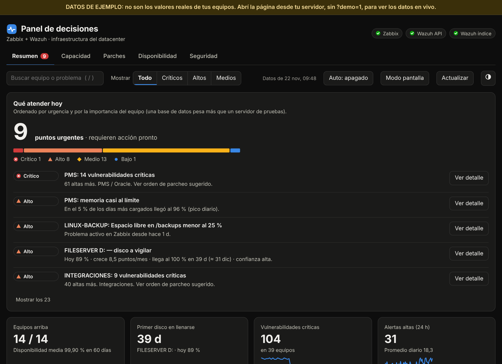

# Panel de decisiones: Zabbix + Wazuh + MikroTik

[](https://github.com/ivanorzu/panel-zabbix-wazuh/actions/workflows/ci.yml)
[](LICENSE)


Un panel web de **una sola página** que junta Zabbix y Wazuh y responde cuatro preguntas cada mañana:

1. ¿Qué se llena? (discos, RAM, CPU y enlaces, con proyección)
2. ¿Qué parcheo primero? (vulnerabilidades ordenadas por riesgo e importancia del equipo)
3. ¿Qué se cae? (disponibilidad, agentes, interfaces)
4. ¿Qué pasa en seguridad? (inicios de sesión fallidos, bloqueos, y quién golpea el perímetro)

Incluye además un **decoder y reglas de Wazuh para el syslog de MikroTik RouterOS 7**, que alimentan el bloque *Perímetro* del panel: conexiones nuevas desde internet, IP que insisten, puertos más buscados y quién entra (o falla) en la administración del router.



## Qué contiene

| Carpeta | Contenido |
|---|---|
| `panel/` | `index.html` (frontend, un solo archivo, sin dependencias), `api.php` (backend PHP de solo lectura), `config.sample.php` |
| `wazuh/` | Decoders y reglas para MikroTik, regla opcional para bajar el ruido del detector de vulnerabilidades, bloque `<remote>` de syslog |
| `mikrotik/` | Script RouterOS (`.rsc`) con el envío de logs y las reglas de firewall que registran intentos desde internet |
| `tests/` | Simulador de los decoders (`test_decoders.py`, no necesita Wazuh) y chequeos de higiene (`validate_repo.py`) |
| `docs/` | Guía de instalación, [PDF técnico del decoder y las vistas](docs/guia-decoder-mikrotik-y-vistas-wazuh.pdf) y capturas |

## Probarlo en 10 segundos

Abrí `panel/index.html` en el navegador con `?demo=1` al final. Muestra datos de ejemplo, sin servidor ni claves.

## Cómo funciona

```
Navegador ──► api.php ──┬─► Zabbix API (token de solo lectura)
                        ├─► Wazuh API   (usuario readonly)
                        └─► Wazuh Indexer (usuario con permiso de lectura)
MikroTik ──syslog UDP 514──► Wazuh (decoders + reglas 1008xx) ──► Indexer ──► bloque Perímetro
```

- Las claves quedan en el servidor (`/etc/panel-decisiones/config.php`, fuera del directorio web); el navegador solo habla con `api.php`.
- `api.php` solo acepta GET y nunca escribe en Zabbix ni en Wazuh.
- Si una fuente cae, el panel lo dice en vez de mostrar datos vacíos como si todo estuviera bien.
- Las proyecciones de capacidad usan Theil–Sen (mediana de pendientes): no se dejan engañar por un pico aislado ni por una limpieza de disco.

## Instalación

Ver [docs/INSTALACION.md](docs/INSTALACION.md). Resumen:

1. Copiar `panel/` a `/var/www/html/panel/` (Apache + PHP) en la VM de Zabbix.
2. Crear usuarios **de solo lectura** en Zabbix (token API) y Wazuh (API + Indexer) y completar `config.php`.
3. Restringir el acceso y agregar cabeceras de seguridad con Apache (ver `panel/apache.conf.sample`).
4. Opcional: copiar `wazuh/` al servidor Wazuh y cargar `mikrotik/syslog-wazuh.rsc` en el router para activar el bloque *Perímetro*.

## Probado con

Zabbix 7.0, Wazuh 4.14 (todo-en-uno), RouterOS 7.18 (MikroTik CCR2216), PHP 8.x, Apache. Los decoders y reglas se validaron con `wazuh-logtest` y alertas reales; el panel, con datos de ejemplo y un simulador de ambas APIs.

## Seguridad

- Usá solo usuarios de solo lectura, distintos de tus administradores.
- No subas nunca `config.php` (ya está en `.gitignore`).
- Verificá el certificado de Wazuh con tu CA (`cafile` + `verify_tls`) cuando puedas.

## Documentación

- [Guía de instalación](docs/INSTALACION.md)
- [PDF: cómo se desarrolló el decoder de MikroTik y las vistas de Wazuh](docs/guia-decoder-mikrotik-y-vistas-wazuh.pdf)
- [Changelog](CHANGELOG.md) · [Política de seguridad](SECURITY.md)

## Limitaciones conocidas

- Probado contra una instalación real de Zabbix 7.0 + Wazuh 4.14; las plantillas de Zabbix propias (con otras claves de ítem) pueden requerir ajustes.
- Las cifras de *Perímetro* son mínimas por diseño: el router limita el registro a 2 eventos por segundo.
- Los nombres de campo del indexer pueden variar entre versiones de Wazuh.

## Contribuir

Issues y pull requests son bienvenidos (ver [CONTRIBUTING.md](CONTRIBUTING.md)). Si una tarjeta sale vacía con tu versión de Wazuh o con plantillas propias de Zabbix, abrí un issue con una alerta de ejemplo (JSON, **sin datos sensibles**).

## Licencia

[MIT](LICENSE) · Autor: Iván Orzuza ([@ivanorzu](https://github.com/ivanorzu))
